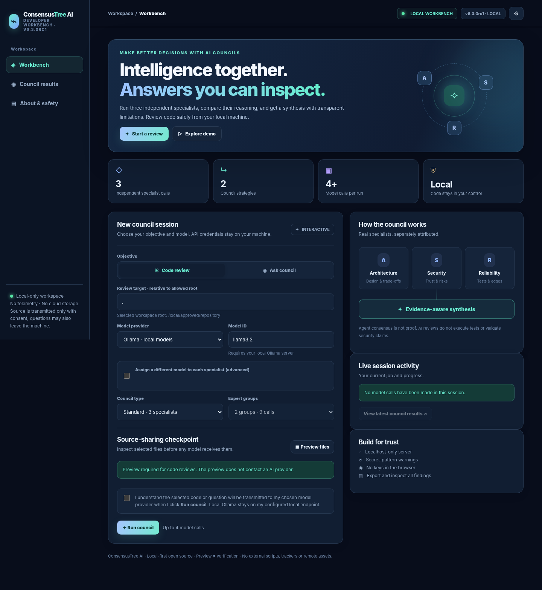
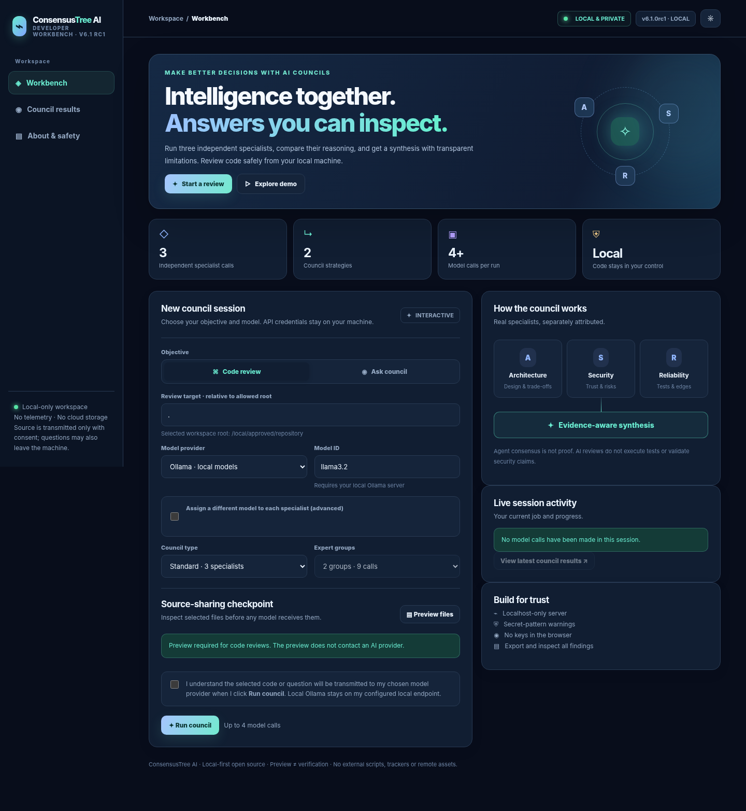

<div align="center">

# 🌳 ConsensusTree AI

**A local-first, human-in-the-loop AI council for code review and technical decisions**

[](https://github.com/minhajul-abedin-ai/ConsensusTree-AI/actions/workflows/tests.yml)
[](LICENSE)
[](https://www.python.org/)

**v6.3.0rc1 · Experimental prerelease · CLI, Python SDK, local browser Studio**

</div>

> ConsensusTree asks multiple model reviewers to examine bounded code or a decision, then presents a chair's synthesis for a person to verify. It is an experimental developer tool, not a production security auditor or hosted multi-user service. AI findings are hypotheses; real-provider validation, independent quality benchmarking and external security review remain outstanding.

## Try the offline demo

No API key or provider request is needed:

```bash
git clone https://github.com/minhajul-abedin-ai/ConsensusTree-AI.git
cd ConsensusTree-AI
python -m pip install -e .
consensustree doctor
consensustree quickstart
```

Open `consensustree-quickstart/sample.html`. The sample is **fictional fixture content**; it does not contact an AI provider. For the local interactive Studio, run `consensustree studio --root ./examples --open`. Keep its private URL to yourself.



[Mobile Studio preview](docs/images/final-studio-mobile.png) · [Report preview](docs/images/final-results-desktop.png) · [Studio instructions](docs/STUDIO.md)

## What it is designed to do

- Gather separate reviewer perspectives and a chair's synthesis.
- Make disagreements, incomplete runs and verification steps visible.
- Let you preview bounded source excerpts and consent before sending them to a hosted provider from the local Studio.
- Produce Markdown, JSON and HTML reports for human review.

The free MIT-licensed source can be used offline for the demo. Hosted model providers may charge for API use. Review [SECURITY.md](SECURITY.md) before sending private code to a provider.

**Current release stage:** the public repository contains the v6.3.0rc1 source, but no GitHub tag or Release has been published yet. Follow the [release checklist](docs/FINAL_RELEASE_CHECKLIST.md) before creating one. Keep the privileged AI PR reviewer disabled until it has been validated on a disposable test repository and PR.

## v6.3.0 RC1 — final prerelease hardening

- The credentialed PR reviewer uses the **trusted-base `pull_request_target` workflow** (not `pull_request`); source from PRs is inspected as Git diff data only, never executed. Repository opt-in is still required, and fork PRs are excluded. GitHub may apply repository Actions policies to this event; validate it on a real, disposable test PR before enabling. See `docs/FINAL_RELEASE_CHECKLIST.md`.
- Remote Ollama endpoints require HTTPS (loopback HTTP remains supported) to reduce accidental plaintext source disclosure. Provider output is bounded at 64,000 characters; excessive/malformed responses fail rather than entering a larger prompt.
- **Release status:** Suitable for publishing as an experimental, free, open-source developer prerelease. **Not cleared** for internet-hosted multi-user production or unsupervised security auditing. Live-provider, independent quality and external pentest gates remain open.

## v6.2.5 RC1 — GitHub workflow, smart scanning, usage accounting and benchmark path

The free/open-source core remains MIT licensed. Latest features:

- **Smart context selection (opt-in on CLI):** `consensustree review . --smart-context --focus authentication --dry-run`. Git changes, file-name relevance, rough imports and related tests influence which files are selected; bounded limits and privacy exclusions still apply. Studio uses this selection by default. This does **not** index an entire repository exhaustively.
- **Provider token usage:** if an API sends usage metadata, outputs record real *provider-reported* token counts. Optional `--pricing-file examples/pricing.example.json` with rates you verified produces an **estimated** cost, not a charge/invoice. Replace the placeholder model and prices before relying on cost estimates.
- **GitHub PR automation:** `.github/workflows/ai-pr-review.yml` runs ONLY after repo administrators create `CONSENSUSTREE_AUTO_REVIEW=true` in GitHub Actions repository variables and configure the OpenAI API key secret. Internal PRs only; trusted base checkout; no repository tests; updates existing bot comment. This workflow still needs actual GitHub Actions execution to validate.
- **Actual production workflow benchmark harness:** `python -m consensustree.production_benchmark run --execute --max-cases 2` runs the shipped Council against the one-model baseline; `score` accepts independent assessor declarations. It does not magically generate independently reviewed labels or genuine results without real models and assessors.
- **Security:** GitHub dependency review workflow, timeout for local HTTP client connections, and an assessor handoff document. No independent security certification has happened. The Studio remains local-only, NOT a cloud service.

See [release record](docs/RELEASE_6_2_5.md), [independent benchmark protocol](docs/assessment/INDEPENDENT_ACCURACY_PROTOCOL.md), and [security handoff](docs/assessment/EXTERNAL_SECURITY_HANDOFF.md).

## v6.2.4 RC1 — privacy, safer defaults and honest coverage (29 October 2026)

- Fixed sensitive directory exclusions on case-sensitive filesystems, including upper-case directory variants in normal and Git scanning.
- Added privacy preflight to `ask` and non-source `debate` CLI calls, and to SDK basic/hierarchical councils (opt-in override remains available for explicitly approved input).
- Corrected stale UI version and duplicate HTML `class` attributes.
- Display eligible/omitted source counts in Studio preview and code-review metadata; a bounded review is **never** a full-codebase audit.
- The cross-platform CI matrix later passed on GitHub-hosted Ubuntu, macOS and Windows runners for Python 3.10–3.13 ([latest run](https://github.com/minhajul-abedin-ai/ConsensusTree-AI/actions/runs/40807862179)).
- Existing baseline plus 12 new security/correctness regression tests. No real hosted provider calls or external security certification have been performed.

## v6.2.3 RC1 — privacy and benchmark hardening (28 October 2026)

- **Safer source reads:** use identity-checked, bounded, regular-file descriptors; reject symlink replacement and unsupported filesystem names instead of accidentally reading outside files.
- **Private Git diffs:** exclude credential-named and generated folders (including `secrets/`), malformed filename encodings, and control-character filenames from changed-file samples.
- **Honest accuracy evaluation:** duplicate, non-final, or ambiguous `VERDICT` responses count as abstentions rather than accuracy successes.
- **Provider resilience:** safely ignore malformed non-string text fields and reject oversized HTTP responses.
- **Improved report disclosure:** clearly distinguish limited secret warnings, user-authorized test execution and reference matching from genuine bug verification.

**Historical v6.2.3 validation:** 141/141 Python tests passed (including 16 new regressions) and 5/5 mocked Chromium viewport tests passed on the build system. Wheel install validation and packaging instructions are in `docs/RELEASE_6_2_3.md`. No actual hosted provider or independent external security reviewer has validated this release. See `docs/VALIDATION_6_2_2.md` for the inherited test protocol.

## ✨ v6.2.2 validation update — more reliable, inspectable local Studio

Run new reviews **from the browser**, not just by CLI. The new web workbench is bound to `127.0.0.1`, requires a random access token, allows one active job, and never accepts API keys from the webpage. You must preview selected code excerpts and explicitly approve sharing before sending them to the model.



[Mobile screenshot](docs/images/studio-mobile.png) · [Results screenshot](docs/images/results-desktop.png) · [Interactive fictional showcase](examples/interactive_showcase.html) · [Local Studio instructions](docs/STUDIO.md)

### Changes through v6.2

- **Reference integrity audit:** compare file:line citations against the exact numbered excerpts provided; counts are **not** evidence of true bugs.
- **True 3-role rotation:** one or two model specs still run three independent reviewer calls.
- **Choose a different model for each reviewer** in the local web workbench (advanced toggle).
- **Inspect the exact source text** before consenting to send the bounded snapshot.
- **Git-aware scanning:** Git ignore rules apply for repositories and nested subdirectories.
- **Less accidental disclosure:** local absolute repository path removed from prompts; best-effort credential detection also runs on questions.
- **Safer Git inputs:** reject option-like Git revision parameters.

[Interactive fictional v6.1 preview](examples/interactive_preview_v61.html) · [v6.1 Studio usage](docs/STUDIO.md)

### New in v6.2

- **Incomplete council detection:** reports explicitly state when a reviewer or chair fails. A partially successful run cannot be mistaken for full consensus.
- **Unrecognized citations:** reports flag `missing.py:123`-style references to files not included in the source excerpt.
- **Safer SDK model configuration:** provider/model identifiers are validated centrally before use in API URLs.
- **Clearer integrity report:** duplicate integrity sections removed, and the browser highlights partial outcomes.
- **Accuracy remains unmeasured:** matching a citation to a provided line does not establish that any claimed defect is real.

### Additional v6.2.1 safety fixes

- Source-share consent is now bound to the exact *target location* as well as the preview text; similar subprojects cannot reuse each other's approval fingerprint.
- Broken or unavailable Git file listings fail closed when Git metadata is present. Fix Git errors before using hosted review providers; we do not fall back to scanning potentially ignored files.
- Source file names with control characters are skipped to protect report/source delimiters.

### Start the live local app

```bash
# Python 3.10+; run inside the extracted project root
python -m pip install -e .
consensustree studio --root ./examples --port 8765 --open
```

The terminal prints a private `http://127.0.0.1:8765/?token=...` URL. If `--open` cannot launch your browser, copy that URL manually. Never share this URL. Use **Explore demo** without keys, or configure your model provider in the terminal for live analyses.

For an offline design preview without Python, open `examples/interactive_showcase.html`. **Everything in that showcase is fictional, with zero model calls.** The previous v5.3 offline report viewer also remains available via `consensustree dashboard`.

### Configure a provider

```bash
# Local model option: install/start Ollama separately and pull a model
ollama pull llama3.2
# Or select a hosted provider by setting its API key in your terminal:
export OPENAI_API_KEY="your-key"       # macOS/Linux
# Windows PowerShell: $env:OPENAI_API_KEY="your-key"
```

Select Ollama or OpenAI in the browser. API use from hosted providers may incur charges. No provider secrets are saved to the browser, to HTML reports or to the project repository. Real external provider calls have **not** been certified in this release.

## New: Validation harness (v6.2.2)

This release adds **50 author-labelled synthetic code snippets** (25 known-risk examples with 25 fixed counterparts), an opt-in live-provider probe, single-vs-council measurement with explicit abstention counts, and an internal local HTTP security test suite. **No genuine model response, measured AI accuracy, or independent third-party security assessment is claimed.**

```bash
# Check access without making provider requests:
python -m consensustree.validation live --output live-validation.json
# After configuring and approving paid provider use, request ONE completion per provider:
python -m consensustree.validation live --execute --providers openai --output live-validation.json
# Review corpus and run at most two cases (10 calls) if a model is configured:
python -m consensustree.validation accuracy --suite benchmarks/accuracy_cases.json
python -m consensustree.validation accuracy --execute --provider ollama --max-cases 2 --max-calls 10
# Run internal security regression (not a pentest):
python -m unittest discover -s tests -p test_security_assessment.py -v
```

Read `docs/VALIDATION_6_2_2.md` and `docs/EXTERNAL_REVIEW_HANDOFF.md` for limitations and independent review acceptance criteria.

## Why use it?

A single LLM can miss context or hallucinate vulnerabilities. ConsensusTree requests separate perspectives and has a chair compare them. The goal is to **surface disagreements and concrete verification steps**, not to use majority voting as a substitute for evidence.

```text
Code snapshot / Git diff / Decision question
                       |
            Independent reviewers
        Architecture | Security | Reliability
                       |
             Group discussions    <- hierarchical mode
                       |
                Final chair
                       |
       Report JSON / Markdown / Interactive HTML
                       |
     Human verification; optional local tests
```

## Six release milestones (v1 through v6 RC1)

| Milestone | Implemented scope |
|---|---|
| v1 | Multi-provider agent CLI, basic reports, local scanner |
| v2 | Offline Git-diff analysis and explicit opt-in Python test execution |
| v3 | Multiple groups, independent reviewers, intermediate chairs, group summaries, call budgets |
| v4 | Self-contained local dashboard, measured request metadata, Dockerfile |
| v5 / hardening v5.3 | Opt-in plugin entry points, GitHub PR-comment preview/post, secret-pattern warning, phrase-check suite, offline Decision Studio |
| v6 RC1 | Local browser workbench, token-protected HTTP API, source preview and consent, model-run status, council results and safe exports |

**Important limitations:** Actual provider requests were not tested in this environment. No vulnerability detection accuracy, reasoning-quality advantage, deployment scaling, or financial ROI has been established. The current suite checks deterministic implementation behavior; it is not a model quality benchmark.

## Install

```bash
# Python 3.10 or newer, from the extracted project root
python -m pip install -e .
consensustree doctor
consensustree quickstart
```

The `quickstart` command produces three offline files (`sample.md`, `sample.json`, and `sample.html`) inside `consensustree-quickstart/`. Open `sample.html` in a browser. It is deliberately labelled as **illustrative fixture content**, not an AI evaluation.

### See a review without sending source code

```bash
consensustree review ./examples --dry-run
consensustree pr-review . --base HEAD~1 --head HEAD --dry-run
consensustree debate 'Should our API use a queue?' --groups 2 --dry-run
```

`pr-review` uses your local Git history and requires the specified commits to exist. Nothing is posted to GitHub by `pr-review` itself.

### Ask an actual provider (API account and billing may be required)

```bash
export OPENAI_API_KEY="YOUR_API_KEY"  # set locally, never commit
consensustree ask "Should our team split this monolith?" \
    --provider openai --model gpt-4.1-mini \
    --output reports/decision.md --json reports/decision.json

consensustree dashboard reports/decision.json --output reports/decision.html
```

Other options are `--provider gemini`, `--provider anthropic`, `--provider ollama` (local Ollama service installed separately), or `--models openai:model,gemini:model,anthropic:model` for model-by-agent routing. Available models, authentication requirements, pricing and access change independently of this tool. Choose models available to your account.

**Privacy:** A model run on a code snapshot will transmit source content to the selected external API or plugin unless you use your own local Ollama endpoint. File scanning is bounded (20 files, 24,000 characters by default), ignores many sensitive file names and detects only certain obvious secret patterns. **Git worktrees apply Git ignore rules; this is still not a complete credential scanner.** Audit all source content and API recipients first.

### Review a codebase

```bash
consensustree review . --dry-run
consensustree review . --provider ollama --model llama3.2 \
    --json reports/code.json --output reports/code.md
```

For local Ollama first run `ollama pull llama3.2` and start the Ollama server. This tool does not fetch models automatically. Smaller models may yield less useful analysis.

### Review a Git diff

```bash
consensustree pr-review . --base main --head HEAD --dry-run
consensustree pr-review . --base main --head HEAD \
    --provider openai --json reports/pr.json --output reports/pr.md
```

The change is extracted using `git diff` locally; it is **not** automatically authenticated against a GitHub pull request. Review the change yourself for secrets before using a hosted API.

### Hierarchical reasoning

```bash
# 2 groups * (3 specialists + 1 group chair) + final chair = 9 calls
consensustree debate "Evaluate adopting event sourcing" --groups 2 --max-calls 9 \
    --provider openai --json reports/debate.json --output reports/debate.md

# Automatic group count uses a transparent keyword/length heuristic,
# not a learned uncertainty or accuracy classifier.
consensustree debate "Security architecture risks" --adaptive --max-calls 15 --dry-run
```

The hierarchical strategy can cost more than a simple council. The `--max-calls` option enforces a request-count cap, **not** a monetary spending limit. Local token estimates in reports are approximate, not provider billing data.

### Use real test execution (only with trusted code)

```bash
# The --unsafe-execute flag explicitly consents to running repository code.
consensustree verify ./my-trusted-repo --unsafe-execute \
    --output reports/test-evidence.json

consensustree review ./my-trusted-repo --provider ollama \
    --evidence reports/test-evidence.json --json reports/review.json
```

Test logs in an imported report are **user-supplied, unauthenticated metadata**. They can be modified and are not proof that an AI claim is correct. `verify` currently supports Python `unittest` under a `tests/` directory only. It does **not** sandbox test execution.

### GitHub PR comments (explicit action only)

```bash
# Safe preview: prints first 500 characters, no network request.
consensustree github-comment --repo YOUR_NAME/YOUR_REPO --pr 12 --report reports/pr.md

# Intentional action: post a comment to the PR. Requires write permission.
export GITHUB_TOKEN="YOUR_GITHUB_TOKEN"
consensustree github-comment --repo YOUR_NAME/YOUR_REPO --pr 12 \
    --report reports/pr.md --confirm
```

Nothing is posted without `--confirm`. Treat AI text as suggestions and inspect the full Markdown before publishing. Github issue comments may be visible to others. Authorization uses the GitHub API.

### Plugins and open Python API

Plugins are regular installed Python entry points under `consensustree.providers`; they are imported **only** when `--plugin NAME` is explicitly supplied. Third-party plugin code executes with your local permissions. Do not install or run plugins you do not trust.

```bash
python -m pip install -e ./examples/plugin_provider
consensustree plugins list
consensustree ask "Is this demonstrative?" --plugin fixture --json report.json
```

The `fixture` plugin returns **fixed demo text**, not AI-generated analysis.

```python
from consensustree import Council, HierarchicalCouncil, ModelSpec

models = [ModelSpec("openai", "gpt-4.1-mini")] * 3
simple = Council(models).ask("Should our service use background jobs?")
print(simple.synthesis)
advanced = HierarchicalCouncil(models, groups=2, max_calls=9).ask("Evaluate the risks")
print(advanced.synthesis)
```

You can inject a compatible `.complete(spec, system, user)` client for tests or custom integrations.

### Limited benchmark checks

```bash
consensustree benchmark --suite benchmarks/suite.json \
    --reports benchmarks/fixtures --output reports/fixture-check.json
```

The included benchmark tests deliberately use synthetic saved fixture reports and measure **expected phrase coverage only**. Even 100% coverage here does **not** establish real-world accuracy, calibrated confidence, better coding outcomes or higher GitHub popularity. Replace the fixtures with independently curated, held-out cases and human-labelled results before making model-quality claims.

## Tests

```bash
python -m unittest discover -s tests -v
python -m compileall -q src tests
```

GitHub Actions includes a Python-version matrix. Unit tests make no billed external API calls; one adapter test uses a temporary local fake HTTP server. The optional Playwright UI check uses fictional, offline data. The Dockerfile is for the CLI; the Studio is intentionally localhost-only and is not configured for remote hosting.

## Responsible development

- See [SECURITY.md](SECURITY.md) before sending repository data to external providers or executing tests.
- See [CONTRIBUTING.md](CONTRIBUTING.md) for the contribution workflow.
- See [docs/VALIDATION.md](docs/VALIDATION.md) for quality gaps, tested/unverified boundaries and release readiness.
- See [docs/GROWTH.md](docs/GROWTH.md) for an adoption and benchmark plan and [docs/PUBLISH_CHECKLIST.md](docs/PUBLISH_CHECKLIST.md) before publishing. Stars are a social adoption metric; they cannot be manufactured by shipping versions.

## License

MIT. See [LICENSE](LICENSE).
